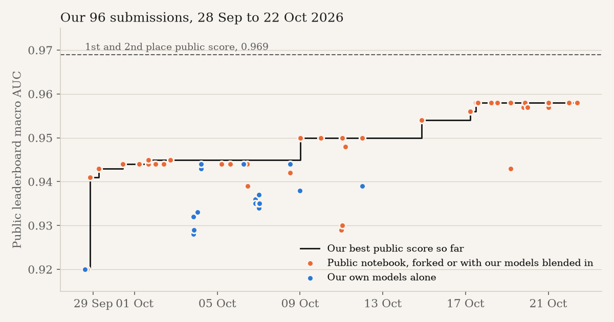

# The Full Campaign: What We Built and What the Leaderboard Said

This is Post 04 of the [RSNA Knee Imaging Playbook](../index.html). The contest, [RSNA Knee Abnormality Detection](https://www.kaggle.com/competitions/rsna-knee-abnormality-detection), closed on 22 October 2026. This post covers the whole campaign after [Post 03](03-first-simple-models.html): what we built, what each step scored, and where the time and money went. [Post 05](05-winning-solutions.html) compares it with the winning solutions.

**Final result:** private leaderboard **0.942** macro AUC, rank **1,336 of 6,425** teams. No medal. The bronze line was also 0.942, but it fell inside a tie of 1,322 teams that had all submitted copies of the same public notebooks, and ties are ordered by submission time.

---

## The short version

| Phase | Dates | Best public score | What decided it |
|---|---|---|---|
| Greenfield models, keyword labels | Aug to 22 Sep | no submission (gold-58 ≈ 0.59 to 0.73) | thin input, weak labels, a noisy ruler |
| Own CoAtNet on the public geometry | 23 to 28 Sep | 0.920 | public LLM report labels + a dense 80-slice input |
| Public stack + our members | 29 Sep to 8 Oct | 0.945 | the public stack; our models added 0.001 to 0.002 |
| Forks of new public notebooks | 9 to 17 Oct | 0.950 → 0.958 | other people's new models |
| Specialists on weak findings | 12 to 22 Oct | 0.958 (no change) | gains too small to see at three decimals |
| Private leaderboard | 23 Oct | **0.942** | the same as every copy of the public notebooks |

*Every scored submission at 0.90 or above. Probes that blank or reverse a column on purpose are left out. Blue dots are our own models with no public notebook inside; orange dots contain a public notebook.*

Our own models alone never scored above **0.939** on the public board. The winners' single models scored **0.964 to 0.969**. Post 05 shows that most of that gap came from one thing: the quality of the training labels.

---

## Phase 1: greenfield models (August to 22 September)

Posts 01 to 03 describe this phase. In summary:

- **Model:** frozen DINOv2 (a pretrained vision transformer) on a thin cache: 3 series × 12 slices × 224 px per study.
- **Labels:** keyword rules over the multilingual reports, later a constrained Qwen LLM fill.
- **Ruler:** macro AUC on the 58 expert-labelled training studies ("gold-58").

What we learned:

1. **The ruler was too noisy for our A/B tests.** Three seeds of the same recipe gave 0.592 ± 0.021 on gold-58. A difference of 0.005 between two recipes was noise. We set the keep margin from measured seed noise and banned single-seed comparisons.
2. **Per-label gold reads are noise at n = 58.** Two label sets with identical ACL labels gave ACL AUCs of 0.770 and 0.596.
3. **Most "obvious" upgrades failed on the honest ruler:** unfreezing the backbone (collapse, −0.114), 24 slices instead of 12, 336 px instead of 224, more series, expert-only fine-tuning, and an external knee MRI set (KneeMRI ACL AUC 0.53, close to chance, because of domain shift).
4. **Label micro-tuning had stopped paying.** Dropping coin-flip LLM fills for ACL and MCL helped once (+0.024 on 46 experts). After that, label variants were tied within noise.

By 22 September the best greenfield model was far below the public notebooks (about 0.936 on the public board). We changed course.

---

## Phase 2: public geometry, public labels, own training (23 to 28 September)

- **Labels:** two public LLM report-label tables (CC0) replaced our keyword teachers. On the experts they scored **0.870** macro AUC against **0.63 to 0.65** for keywords. This was the largest single gain of our campaign, and it came from a better teacher, not a better model.
- **Input:** our own 80-slice "dense80" cache, built with the public test-time slice picker so training and test used the same geometry.
- **Training:** a CoAtNet-384 on rented RunPod GPUs (~$0.34 to $0.74 an hour).
- **Search:** an autonomous loop in which a DeepSeek planner proposed one-field changes to a typed recipe and launched pods.

First own-weights submission: fold-0 proxy **0.9366**, public **0.920**. The local proxy was optimistic by 0.017. The autonomous loop mostly varied learning rate, weight decay and epochs, and those changes stayed within ±0.003. We later closed that axis in code, and paused the strategist after 40 turns ($3.65) produced nothing new.

---

## Phase 3: our models inside the public stack (29 September to 8 October)

A public "D4" stack scored 0.943. We added our CoAtNet members by swapping them into its slots or by rank-blending them at the final level.

| Submission | Public |
|---|---:|
| D4 stack + our model in the v5 slot | 0.943 |
| + a 4-seed soup of our best-label members | 0.944 |
| + CoAtNet branch weight +0.15 | **0.945** |
| + per-finding tails, fused labels, fine-tuned DINO, 15 to 20 own models at w 0.25 to 0.60 | 0.939 to 0.944 |

What we measured:

- **Self-training made labels agree better with the experts but did not make better models.** Labels fused from report and image predictions scored 0.946 to 0.949 against experts (report labels 0.883), but members trained on them were flat (0.9315 to 0.9330 on gold-58).
- **Signal added inside a big stack is diluted.** Our members sat in slots with about 0.25 effective weight. A +0.011 expert gain there showed as +0.001 on the board, and smaller transplants did not show at all.
- **Our models alone scored 0.928 to 0.939.** Only a model whose errors differ from the stack's, and which is strong on its own, can lift a blend. Ours were neither.
- **We found a leak in our own baseline.** A public checkpoint we warm-started from had seen every training study, so its out-of-fold scores were inflated by about 0.03 to 0.04. Three of our model families looked like failures until we compared them with a clean ImageNet-initialised baseline.

---

## The pilot we parked (9 October)

On 9 October we tested an **LLM image reader**: Claude Opus with a slice viewer read two training studies end to end (69 to 81 views, ~200k tokens each) and gave Present/Absent per finding. It agreed with the experts on 17 of 24 cells. It handled ACL, effusion, Baker's cyst, gross OA and MCL well, and struggled with menisci, synovitis, fine cartilage and contusion versus fracture.

An 18-study test would have cost about $60. We parked it to keep the money. **In hindsight this was our biggest miss.** An LLM agent reading the images to build training labels is the step every top team took (Post 05).

---

## Phase 4: forking the new public notebooks (9 to 17 October)

From 7 October new public notebooks reached 0.950, then 0.954, 0.956 and 0.958. Hundreds of teams forked them, so a forked score did not change anyone's rank. We forked each new best:

| Date | Fork | Public |
|---|---|---:|
| 9 Oct | four public notebooks, unchanged | 0.950 |
| 14 Oct | blend-mine (expert-trained CoAtNet + compact ConvNeXt) | 0.954 |
| 17 Oct | an older blend version | 0.956 |
| 17 Oct | blend-mine and goodpjw2008 0.958 versions | **0.958** |

To see how the public steps were made, we read the notebooks. Each step from 0.950 came from **one new independent model** rank-blended at 0.2 to 0.5: a model with zoomed, side-aware local views of the knee, or one trained on knee-compartment crops. A third general model at 0.25 added nothing.

Own experiments during this phase:

- **Sequence-fused windows** (fluid-sensitive slice, non-fluid slice and their difference as RGB): 0.930 alone against 0.929 for its twin. Closed.
- **Training on the public expert-trained model's ordering of the training studies** ("labels_t2"): **0.939** alone against 0.929 for an identical control, +0.010. This was our best own-model result, and it was another label effect.

---

## Phase 5: specialists for the weak findings (12 to 22 October)

The 0.950 to 0.958 notebooks were weakest on Lateral OA, Synovitis, PF OA and the menisci. We trained region specialists on knee-compartment crops on RunPod and read each finding's AUC on the leaderboard with **column probes**.

**Column probe:** submit real predictions in one column and 0.5 everywhere else. The other 11 columns each score 0.5, so the finding's AUC is 12 × score − 5.5 (about ±0.006).

| Finding | Public base | Our specialist alone |
|---|---:|---:|
| Lateral OA | 0.896 (0.950 base), 0.908 (0.958 base) | 0.908 |
| Medial Meniscus | 0.980 | 0.980 |
| Lateral Meniscus | 0.950 | 0.944 |
| PF OA | 0.926 | 0.920 |

The specialists caught up with the public base on two findings and did not beat it on any. Added at weight 0.4 to 0.5, every candidate still scored 0.957 or 0.958.

A related tool, the **reversal probe**, flips one column (1 − p) and reads the drop. It told us which findings had room to improve before we spent GPU time on them.

---

## Finals and the private board

Kaggle orders identical scores by submission time, so a plain copy of a public notebook ranks behind every earlier copy. Our two finals were:

1. The 0.958 blend-mine copy + our compartment specialist at 0.4 on Lateral OA and Medial Meniscus (public 0.958 → private **0.941**).
2. A plain goodpjw2008 0.958 copy (public 0.958 → private **0.942**).

The highest private score among all 96 of our submissions was 0.942. No choice of finals would have won a medal. All the public 0.958 notebooks finished at 0.941 to 0.942 private. They lost 0.016 between boards, while the winners lost 0.009 to 0.013 (Post 05).

---

## Operational lessons

These cost us days, not points:

- **Never loop on a refused submission.** A launchd job that retried a refused submit got the whole account locked for about 40 hours, website included. A submit script should make one call and stop on any error other than the daily cap.
- **A forked notebook attaches the latest dataset versions.** Twice a fork scored 0.001 to 0.002 below its source, and once it failed three times, because a dataset had changed underneath it. Check the model files a notebook expects against each dataset's current manifest before pushing.
- **Hidden-test run time varies.** The same code took 6 to 8.5 hours of the 9-hour limit. Every optional stage needs a time guard that falls back to the base output.
- **Kaggle GPU quota (30 h a week) runs out mid-week.** Use it only to save submission notebooks and train elsewhere.
- **Unattended scripts on a laptop die** with sleep and reboots. Use `caffeinate`, and check the processes at the start of every session.

---

## What the campaign proved

1. **Labels were the ceiling, and we saw it twice without acting on it.** Public LLM labels instead of keywords gave our biggest gain. Training on a better model's ordering gave +0.010. A label-construction pilot looked promising and was parked.
2. **Improving a big public stack by 0.001 steps does not win medals.** The public stack ended in a 1,322-team tie on both boards. A medal needed a model that beat the stack on its own.
3. **Leaderboard probes were our most reliable ruler.** Column and reversal probes gave per-finding AUC on the real test distribution. Gold-58 put models in the wrong order three times.
4. **Automation needs a goal it can reach.** The autonomous loop ran pods for weeks, but only on the parts of the recipe that did not matter.

---

## Attribution

Series: [Post 01](01-imaging-playbook.html) · [Post 02](02-eda-problem-shape.html) · [Post 03](03-first-simple-models.html) · [Post 05](05-winning-solutions.html).

Public notebooks we forked or built on (Apache 2.0): heliosli, goodpjw2008, evgendvorkin, jiweiliu, pjmathematician. Public report-label tables (CC0): pilkwang, dreaddevelopment.

Code, probes and the full experiment log (`docs/STATUS.md`, `docs/experiments.md`, `docs/DECISIONS.md`) are in the public monorepo: [RSNA_Knee_Abnormality_Detection_Model](https://github.com/Girish011/RSNA_Knee_Abnormality_Detection_Model).
