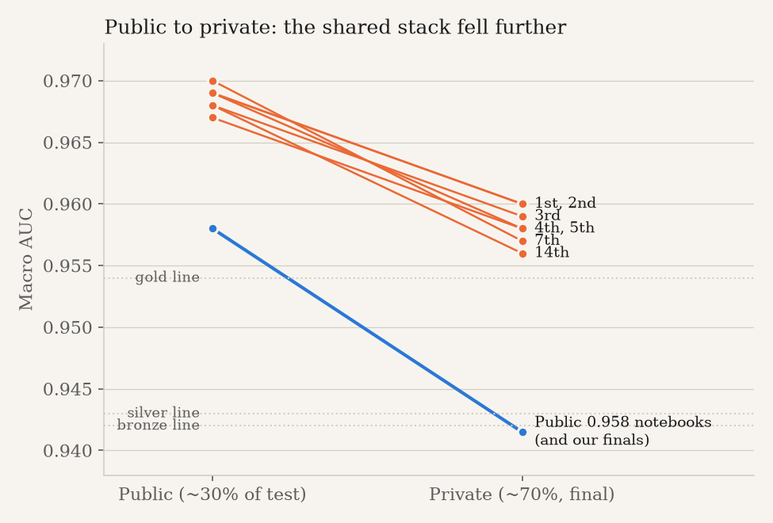
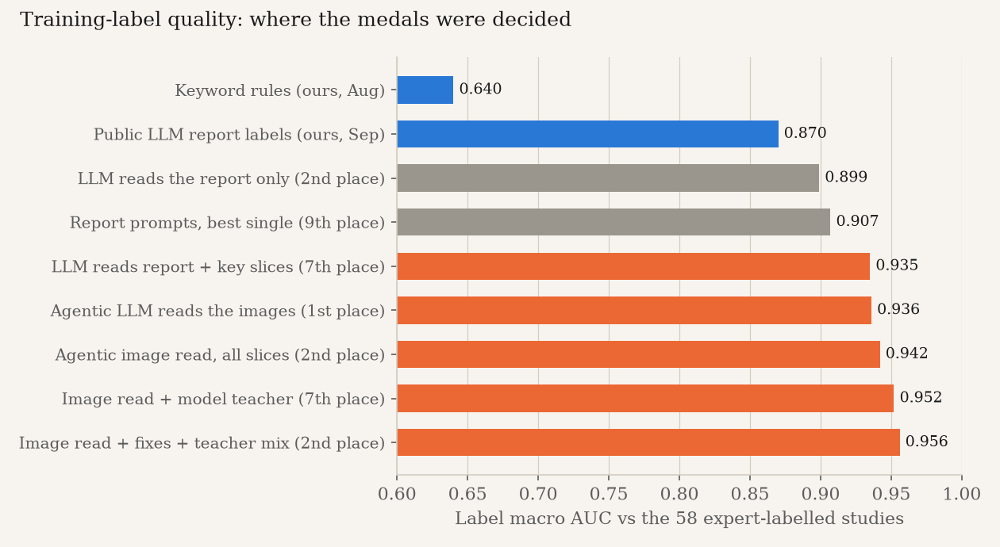

# How the Winners Did It, and What to Learn

This is Post 05 of the [RSNA Knee Imaging Playbook](../index.html). [Post 04](04-full-campaign.html) covered our own campaign (private 0.942, rank 1,336 of 6,425). This post summarises the top teams' published write-ups and compares them with what we did. Every number here comes from the authors' own posts on the competition forum, linked at the end.

---

## The top of the board

| Place | Team / write-up | Public | Private | One-line summary |
|---|---|---:|---:|---|
| 1st | Team Kangaroo (tascj0, liushuzhi) | 0.969 | **0.960** | LLM agents labelled findings, ROI boxes and lesion boxes; box-pooling ConvNeXt |
| 2nd | (first serious competition for the team) | 0.969 | **0.960** | LLM read every slice; six 2.5D MIL models; fixed-weight rank blend |
| 3rd | DataTech, ShanghaiTech | 0.968 | 0.959 | Image-reading LLM labels; OAI supervision; 36 checkpoints |
| 4th | | 0.967 | 0.958 | ChatGPT Pro read rendered MRI pages; CoAtNet-2 MIL |
| 5th | | 0.969 | 0.958 | Calibrated labels + bone-segmentation crops; EfficientNetV2-M / ConvNeXt-B |
| 6th | | 0.969 | 0.958 | Keypoint knee frame; 70 mm tiles; noisy student on 18,500 external knees |
| 7th | solo | 0.970 | 0.957 | Three LLM image reads + model teacher; one architecture, no external data |
| 14th | solo, also 2nd on the efficiency board | 0.968 | 0.956 | One network finds the knee; report labels only |

The gold line was 0.954 private. The 0.958 public notebooks that most teams forked, including ours, finished at 0.941 to 0.942.

*The medal lines are private-board values. The winners' models lost 0.009 to 0.013 between boards. The shared public stack lost 0.016.*

---

## 1. They treated it as a labelling competition

Every top write-up says the same thing in its first paragraph. Only 58 training studies had expert labels. The other 4,349 had reports, and the hidden test was graded by radiologists **from the images**. Reports miss mild disease and use different thresholds. On the 58 expert studies the experts marked 240 positives where the reports stated 154; for PF OA it was 21 against 2 (2nd place).

So the winners built new training labels by having an **LLM look at the MRI**, not just read the report.

*Training-label quality on the 58 expert studies, as each team reported it. These scores are optimistic because teams also tuned on the 58, but the order is consistent across teams.*

How the best label pipelines worked:

- **Agentic reading.** One unattended agent session per study. The workspace held the report, the competition's own finding definitions, overview sheets of every series, and two tools: `view_slices` (crop, zoom, re-window chosen slices) and `compare_location` (map a point to another series by DICOM geometry). A median study took about 2.5 minutes and 15 images (1st place).
- **Definitions first, evidence before the number.** For each finding the agent quoted the report, cited the image evidence by series and slice, and only then gave a probability. Silence in a report is not a negative; "mild" is not "high-grade".
- **The report as an untrusted colleague.** 2nd place told the reader to treat the report as a read "with known gaps". 7th place's best prompt framed the report as a draft that may contain errors.
- **Every slice, not a sample.** 2nd place's first pilot showed the model 44 of 134 slices and concluded images did not help. With every slice (~277 images per study), label quality rose from 0.899 to 0.942.
- **Score labels like models.** Teams judged each label version on the 58 by AUC, and 1st place also by log loss and the count of confident errors.

Then they **fixed and mixed** the labels:

- **Calibration.** 1st place fit a temperature on the gold studies (p' = σ(0.77 · logit p)) because the LLM was over-confident. 5th place found that hedged "yes" labels near 0.75 were right only 38% of the time.
- **Per-finding rules from the 58.** For example: PF OA studies the reader called "unclear" were all positive for the experts, so they got a floor of 0.8 (2nd place; 6th place used a similar PF OA floor).
- **Per-hospital corrections.** Some sites write "synovitis" whenever there is fluid; others never use the word. 7th place shifted each site's Synovitis labels to match its image-based effusion rate.
- **Teacher mixing.** Out-of-fold predictions of earlier image models were blended back into the labels (0.3 to 0.6 share), rank-mapped so prevalence did not change.

**How much it was worth.** 4th place trained the same network, on the same data, with the same seed, changing only the labels: public/private went from 0.941/0.925 to **0.960/0.952**. For 5th place, better labels were the largest single step (+0.008 private). Our own models alone scored 0.928 to 0.939 on report labels, close to 4th place's "before" number.

---

## 2. They found the knee before classifying it

The second most common idea was localisation:

- **Knee side.** Left knees were mirrored so every knee looks like a right knee. Side came from DICOM tags where available and from a small classifier elsewhere (99.3% held-out accuracy).
- **Where to look.** 1st place had LLM agents draw 3D ROI boxes per finding on 751 studies, trained a detector, and pooled features only inside each finding's box. 5th place trained a bone-segmentation nnU-Net (started from TotalSegmentator) and cut crops of the joint, compartments and patellofemoral joint. 6th place predicted five anatomical keypoints and resampled every series to 0.3125 mm per pixel around the joint.
- **Resolution where it matters.** An 80 mm crop at 384 px is about 0.21 mm per pixel, against 0.39 mm for a 150 mm full field.

Measured gain: 5th place, anatomy-guided crops +0.003 private; 1st place, box pooling + 112 mm crop + in-box attention +0.008 on gold-58.

---

## 3. Simple 2.5D models with per-finding attention

The architectures were similar across the top 10:

- A **2D backbone** (ConvNeXt-T/S/B, EfficientNetV2-S/M, CoAtNet, MaxViT) reads windows of three neighbouring slices as RGB.
- An **attention multiple-instance-learning (MIL) head** pools the windows of each series, then the series of each study, with **separate attention per finding**. Several teams used one learned query per finding.
- **Soft-label BCE**, AdamW, EMA or SWA weights, 20 to 25 epochs.
- **Training-only extras** that cost nothing at inference: a lesion-box head and a report-embedding head (1st place).

Single models reached **0.964 to 0.969 public**. The 1st-place efficiency entry, one ConvNeXt-T, scored 0.964/0.954 in about four minutes. Backbone choice mattered much less than labels and inputs. 2nd place found one input bug, reading 4 slices per series instead of 15, worth +0.033 on gold-58, more than most model changes.

---

## 4. External data helped, but less than labels

- **OAI (Osteoarthritis Initiative) with MOAKS expert grades:** used by 2nd (a PF OA cartilage head), 3rd, 5th (pretraining, +0.001), 6th and 9th place.
- **fastMRI / fastMRI+:** pretraining and the side classifier (2nd), and two noisy-student rounds on ~18,500 external knees (6th, +0.003 public).
- **7th place used no external data** and finished 7th.

Our own external-data test (KneeMRI as an ACL ruler) failed on domain shift. The teams that gained used external data for **pretraining or one specialist head**, not as a ruler or as direct training data.

---

## 5. Small, diverse ensembles with fixed weights

- 2nd place: four core models plus two specialists at a 0.20 share on their own findings. **Tuned blend weights lost 0.002 to 0.007** to fixed weights on held-out studies. A member at 0.959 public alone added nothing because it resembled the others.
- 5th place: the final ensemble tied the best single model on private (0.958).
- 7th place: a rank mean of four models; the single ConvNeXt-S was as good on private.
- 14th place: 15 models equalled 60 models on private.

Rank-averaging per finding was standard, because AUC only reads order. Specialists helped at about 0.20 weight, and only when they were strong and different.

---

## 6. Validation they could trust

- **Gold-58 moves by about ±0.02 by chance.** 2nd place tuned on 24 of the 58 and kept 34 frozen for checking.
- **Site-grouped folds.** Scanner settings reveal the hospital. 5th place grouped studies into 20 hospital-like clusters; a model scored 0.019 higher locally when a study's site was in training, but not higher on the experts.
- **A proxy checked against the leaderboard.** 6th place built a proxy AUC from same-scanner pairs weighted by label confidence; over 61 submissions it tracked the public board with Spearman 0.94. 1st place chose its local metric after correlating it with 20 to 30 leaderboard scores.
- **Public and private agreed for real models.** For 2nd place's submissions above 0.955 public, the two boards ranked them the same way (rank correlation 0.977), and their chosen final was also their best private score.

---

## 7. Engineering inside 9 hours on two T4s

- Decode each study and place crops **once**, then run every model on the shared input (5th place saved about 42% of GPU time).
- One worker process per GPU, fp16, and in the fastest entries TensorRT and C++ DICOM reading.
- A **time budget per stage**, with the stage dropped if it overruns.
- Kaggle's disk read speed varied from about 30 MB/s to over 500 MB/s. 1st place submitted the efficiency entry close to the deadline, when the platform was quiet.

---

## 8. AI agents as labellers and as engineers

Two different uses of AI separated the top teams:

1. **Frontier LLM agents as image labellers** for the training set (GPT-6 Astra, GPT-6.1 Sol, ChatGPT Pro, Claude Opus 5.5). The host allowed commercial LLM APIs for building training data (forum thread 733965). Nothing at inference used an LLM.
2. **Coding agents as research assistants.** 1st place describes asking Claude Opus 5.5 to propose ways to use the box annotations and run the experiments, and says most model gains came from that. Their label protocol was iterated with Codex against the gold studies, and a "trained guide" (the agent writes reading notes from gold cases) reduced confident errors from 35 to 19.

---

## Our approach against theirs

| Area | Winners | Us |
|---|---|---|
| Training labels | LLM agents read every slice + report; calibrated; mixed with model teachers (gold-58 ≈ 0.94 to 0.956) | Public LLM report labels (0.870); an image-reader pilot on 2 studies, parked on cost |
| Localisation | Side classifier, ROI detector / bone segmentation / keypoints, crops at ~0.2 to 0.3 mm/px | Public slice picker; compartment crops only for late specialists |
| Model | 2.5D MIL, per-finding attention, own models 0.964 to 0.969 alone | CoAtNet / ConvNeXt-S, own models 0.928 to 0.939 alone |
| Ensemble | 4 to 6 strong, diverse members, fixed weights | Our members inside a public stack, effective weight ~0.25 |
| Validation | Split gold-58, site folds, proxies checked against the board | Gold-58 (too noisy), then column and reversal probes |
| Time | Labels first, models after | Models first, labels in small steps |

---

## Ten things to learn

1. **Find out what the test labels are made of, and build training labels that match.** Here the test was graded from images and the training data had reports. The gap between the two was the competition.
2. **Measure label quality directly**, on whatever expert set exists, with AUC, log loss and confident errors, before training on a new label set.
3. **Spend early on the expensive idea if it targets the real bottleneck.** Our $60 image-reading test was the right experiment; parking it cost more than any GPU bill.
4. **Give a reader every slice and the tools to look again.** Sampled slices led a team to conclude images did not help; full access reversed it.
5. **Localise the anatomy, then zoom.** Side, box or keypoints, then crops at higher resolution. Every top-6 team did a version of this.
6. **Keep the model simple** and change one thing at a time. A 2.5D CNN with per-finding attention was enough to win.
7. **Do not build on a stack everyone else has.** A shared public notebook ties on both boards. Build an independent model that is strong on its own first; blend after.
8. **Fix blend weights by rule.** Tuned weights over-fit a small check set.
9. **Calibrate your ruler against the leaderboard**, then trust it. Our column probes were the right idea; we found them too late.
10. **Budget the 9 hours from day one.** Shared preprocessing, per-stage time guards, and a fallback output.

---

## Sources

Write-ups on the competition forum (all retrieved 5 November 2026):

- [1st place (tascj0)](https://www.kaggle.com/competitions/rsna-knee-abnormality-detection/discussion/752468) and [1st place (liushuzhi)](https://www.kaggle.com/competitions/rsna-knee-abnormality-detection/discussion/752474)
- [2nd place](https://www.kaggle.com/competitions/rsna-knee-abnormality-detection/discussion/752370)
- [3rd place](https://www.kaggle.com/competitions/rsna-knee-abnormality-detection/discussion/752510)
- [4th place](https://www.kaggle.com/competitions/rsna-knee-abnormality-detection/discussion/755401)
- [5th place](https://www.kaggle.com/competitions/rsna-knee-abnormality-detection/discussion/752190)
- [6th place](https://www.kaggle.com/competitions/rsna-knee-abnormality-detection/discussion/753159)
- [7th place](https://www.kaggle.com/competitions/rsna-knee-abnormality-detection/discussion/752217)
- [9th place](https://www.kaggle.com/competitions/rsna-knee-abnormality-detection/discussion/753754)
- [14th place and 2nd efficiency](https://www.kaggle.com/competitions/rsna-knee-abnormality-detection/discussion/754729)
- [Efficiency track 3rd place](https://www.kaggle.com/competitions/rsna-knee-abnormality-detection/discussion/754458)
- [Host ruling on commercial LLM APIs](https://www.kaggle.com/competitions/rsna-knee-abnormality-detection/discussion/733965)

Series: [Post 01](01-imaging-playbook.html) · [Post 02](02-eda-problem-shape.html) · [Post 03](03-first-simple-models.html) · [Post 04](04-full-campaign.html) · next: [Post 06](06-agent-search-loop.html).
