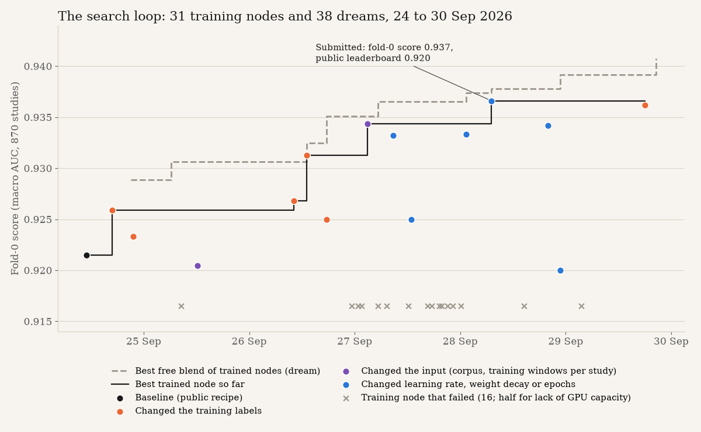
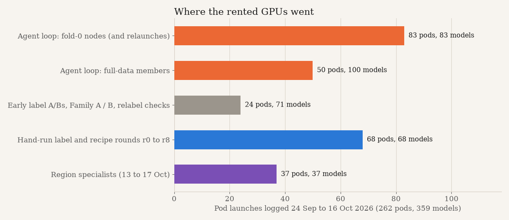

# Letting an Agent Run the Search: What MLEvolve-Style Search Did for Us

This is Post 06 of the [RSNA Knee Imaging Playbook](../index.html). [Post 04](04-full-campaign.html) mentioned an "autonomous loop" in one paragraph. This post covers it in full: we adapted the ideas of **MLEvolve**, an agent that searches over machine-learning experiments, to our competition, and let it plan, launch and score training runs on rented GPUs from 24 September to 2 October 2026. Below is how we built it, what it found, and where it failed. The last sections cover the other half of the spend: the hundreds of runs we launched by hand or by script around it, up to the last week of the competition.

**Short answer:** the harness was useful, and the search inside it was not. Across the whole campaign we launched **262 rented GPU pods that trained 359 models, made 96 leaderboard submissions and spent roughly $300** on GPUs and LLM calls. The agent loop itself ran 31 fold-0 training experiments and 38 free "dream" blends unattended, plus a long tail of full-data models. It made every result comparable, and its best run later served as our clean reference model. But it searched the wrong levers. Its best model scored **0.920** on the public leaderboard, below the public notebooks it started from (0.936). Everything we trained afterwards, by hand and by script, ended where the public notebooks already were: our best leaderboard score was 0.958, level with them, and the private score was **0.942**, rank 1,336 of 6,425.

---

## The short version

| Question | Answer |
|---|---|
| What did we build? | An MLEvolve-style search loop: experiment graph, memory with a ban list, a typed recipe the LLM edits, Dream-RSI replay, DeepSeek as planner |
| How long did it run? | Fold-0 search 24 to 29 Sep; a DeepSeek "strategist" 29 Sep to 2 Oct |
| How much did the loop run? | 31 fold-0 experiments (15 finished, 16 failed; 83 pod launches in all), 38 dreams, 50 full-data member jobs (100 models), 150 planning steps, 80 strategist turns, 16 LLM relabel jobs |
| How much did the whole campaign run? | 262 pods, 359 models, 96 leaderboard submissions, about $300 (RunPod about $250, DeepSeek about $50) |
| Best result | Fold-0 score 0.9215 → 0.9366 (+0.015); public leaderboard 0.920 |
| What moved the score | Training labels and the number of training windows per study. Learning rate, weight decay and epoch changes moved it −0.014 to +0.002 |
| Best single finding | An LLM relabel of Synovitis: 0.80 → 0.87 on the experts, in 4 of 4 models |
| What the rest of the runs found | Nothing beyond the public notebooks: the best own ensemble scored 0.935 to 0.936 alone and added nothing to the stack |
| What we kept | The experiment graph, fixed protocol, per-finding judging of labels, and the submit gate |
| What we stopped | Fold-0 search on 29 Sep; the strategist on 2 Oct |

*Each dot is one finished fold-0 experiment of the agent loop, placed by launch time and coloured by what it changed. The dashed line is the best free blend of finished runs. Crosses are runs that failed. This is only the loop's search; the whole campaign is under "Every run" below.*

---

## Why we tried it

On 23 September we were far behind. Our greenfield models scored about 0.59 on the 58 expert-labelled studies, and a public notebook scored 0.936 on the leaderboard. We had four weeks, a $300 cap, and one laptop. Driving every GPU job by hand meant idle GPUs between jobs and constant monitoring.

Two papers suggested a way to search cheaply:

- **[MLEvolve](https://arxiv.org/html/2606.06473v1)** ([code](https://github.com/InternScience/MLEvolve)) treats ML engineering as a graph search. Each node is an experiment. A Monte Carlo graph search picks which node to extend next; "retrospective memory" stores what worked and failed; a planner model proposes changes and a coder model writes them.
- **[Dream-RSI](https://arxiv.org/html/2609.14858v1)** ([code](https://github.com/zhengkid/Dream-RSI)) treats a finished experiment tree as a replay world: some new ideas can be scored from saved predictions, with no new training. We called these **dreams**.

Our plan said it plainly at the time: these tools make search cheaper and stop repeats, but they do not create the extra accuracy we needed. That has to come from better labels or better input.

---

## How we adapted MLEvolve

Running MLEvolve as published on raw MRI would have spent our budget on install failures and on ideas we had already ruled out. We kept its mechanisms and changed the rest.

**1. A typed recipe instead of free code.** The planner could not write training code. It could only change fields of a fixed recipe (`agent/genome.py`): corpus, label set, training windows per study (a window is three neighbouring slices), epochs, learning rates, weight decay. Each value came from a short menu. A "primary" step changed one field; branch steps could change two or three.

**2. Memory with a ban list.** The static half of the memory (`agent/memory/cold_start.md`) held every measured result from August and September, including a list of banned ideas: unfreezing the backbone on noisy labels, training longer after the expert score peaked, many-backbone ensembles, and judging small changes on the 58 experts. The planner's first proposal was blocked by this list: it tried to unfreeze the backbone, which had collapsed the expert score by 0.114 on 21 September.

**3. The experiment graph and search.** `agent/journal.py` stored every node with its parent, recipe, scores and cost. `agent/search.py` picked the next parent with a progressive tree search (UCT, which balances the best node so far against nodes tried less often) and chose an operator: extend the best node, branch from a sibling, cross two branches, or aggregate. Reward followed the paper: −1 for a failed run, 1 for a valid run with no gain, 2 for a new branch best.

**4. A fixed, paired protocol.** Every run used seed 42 and the same five study folds, and trained on folds 1 to 4. The **fold-0 score** (our "proxy") was macro AUC on the 870 fold-0 studies where the two public LLM label tables agreed. The 58 expert studies were split 29 for checking and 29 held out; the held-out score was never shown to the planner. A child counted as a gain only if seed, folds and corpus matched its parent.

**5. Dreams first.** After each finished run, the loop rank-blended the saved fold-0 predictions of the best runs, pairwise and greedily per finding. Dreams cost nothing and took seconds.

**6. DeepSeek as planner, with tools.** DeepSeek (Flash and V4 Pro models) planned through function calls: `launch_runpod_train`, `request_relabel` (an LLM re-reads the reports for chosen findings), `get_runpod_status` and `stop_search`. The host checked every proposal before anything ran.

**7. Hard gates.** One pod at a time, a $300 campaign cap counting GPU and LLM spend, user approval for any action over $10, and no leaderboard submissions by the agent. A file named `STOP` halted the loop.

The loop ran under `launchd` on the laptop, so it restarted after crashes and reboots.

---

## How it ran

| Date | What happened |
|---|---|
| 24 Sep | Loop live. Baseline run (public recipe, public labels): fold-0 **0.9215**. First relabel (Lateral Meniscus, Fracture): **0.9259** |
| 25 Sep | A corpus download hung for 3.7 GPU hours. Our own 80-slice corpus ("dense80") enabled as the default |
| 26 Sep | Loop idled about 7 hours: the search picked dream nodes as parents, which cannot be trained, and the relabel cap parked every tick |
| 27 Sep | User decision: DeepSeek owns every idle tick and may edit allowlisted harness code. Many pods vanished for lack of capacity |
| 28 Sep | 12 and 16 training windows per study ran out of GPU memory and were banned in code. Best run **0.9366** (20 epochs). First own-weights leaderboard score: **0.920** |
| 29 Sep | Fold-0 search retired. Submissions move to the public stack plus our full-data models. DeepSeek "strategist" starts |
| 30 Sep | Self-training through the loop closed: fused labels gave no better models |
| 2 Oct | Strategist paused by the user |

---

## What the search found

The 15 finished runs, grouped by what they changed:

| Change | Runs | Fold-0 score | Effect |
|---|---:|---|---|
| Baseline (public recipe) | 1 | 0.9215 | reference |
| Label set, same input | 6 | 0.9233 to 0.9362 | up to 0.011 between label sets on the same corpus |
| Our 80-slice corpus | 1 | 0.9205 | −0.005 vs the same labels on the public corpus, at first |
| 8 training windows per study instead of 12 | 1 | 0.9344 | **+0.014**, the largest single step |
| Learning rate, weight decay, epochs | 6 | 0.9200 to 0.9366 | −0.014 to +0.002 vs parent |

Three observations:

1. **The largest gain came from outside the planner.** The switch from 12 to 8 training windows was the host's fallback: when DeepSeek stopped without a valid proposal, the host trained the next untried menu value. It came right after a 16-window run had failed for lack of GPU memory.
2. **Optimizer changes were noise or worse.** Six one-field changes to learning rates, weight decay and epochs landed between −0.014 and +0.002. On 29 September we closed this axis in code, so the planner could no longer propose it.
3. **Dreams beat every single run, and we never used them.** The best 4-way dream blend scored **0.9407**, +0.004 over the best single run. By the time it existed we had moved submissions to the public stack, where fold-0 models had no slot.

**The proxy was optimistic.** The best run scored 0.9366 on fold 0 and **0.920** on the public leaderboard, a gap of 0.017. The proxy measured agreement with report labels on studies where two LLM tables agreed. These are the easier studies, and the hidden test is graded from images.

---

## The strategist and the relabels

From 29 September a second DeepSeek role, the **strategist**, ran every 45 minutes while pods trained. It could analyse per-finding results, request relabels, queue full-data training jobs, and build (but not submit) ensemble notebooks.

The best result of the whole loop came from here. Relabel `c7ab23d1` re-read every report for Synovitis, PF OA and Lateral OA. In four trained models it lifted **Synovitis from 0.80 to 0.87** on the experts. The same relabel **lowered PF OA from 0.86 to 0.80–0.84**, even though its label audit said PF OA labels had improved (0.888 → 0.922 on 29 experts).

That taught us a rule we kept: **judge a label change by models trained on it, one finding at a time**, not by how well the labels themselves agree with the experts. The combined label set `bestof_v1` (the earlier relabel, with Synovitis from `c7ab23d1`) gave both of its models 0.932 on the experts; every other label set gave 0.923 to 0.928.

The rest of the strategist's work was weaker:

- 44 of 80 turns ended with no action, usually because every route was capped or closed.
- 62 of 80 turns ended in free text instead of the required JSON.
- A seed-cap bug let it train six seeds of one label set (~$3) before we fixed it.
- It kept proposing more seeds of models we already had.

On 2 October the user paused it. Our policy file records the reason: the strategist's turns had produced only unapproved seed proposals and non-JSON stops.

---

## Where the agent behaved badly

These are the failure patterns we saw, with counts from the activity log:

- **It repeated itself.** The planner proposed relabelling Fracture 25 times on 25 and 26 September, with small changes of wording. Retrospective memory stored results, but it did not stop near-duplicate ideas. The relabel cap rejected 21 proposals.
- **It stopped without acting.** 22 planner calls ended with no valid tool call. We made `stop_search` refusable and added a mandatory retry.
- **The search picked untrainable parents.** Dream nodes scored best, so the tree search selected them, but a blend has no recipe to train. The loop idled about 7 hours until the host resolved dreams to their best real parent.
- **A long-running process ran stale code.** Fixes reached the loop only after a restart. Once a stale import made every tick fail for about 2 hours; once a new flag was silently ignored.
- **Rented GPUs failed often.** Of 16 failed runs, 8 found no GPU capacity, 5 finished without results, and the other 3 were a hung download, a clash between two pods, and a run stopped by the new memory ban. They cost 8.1 of 64.1 GPU hours. We added heartbeats, phantom-pod detection and automatic relaunches.

---

## What the loop itself cost

| Item | Amount |
|---|---|
| Fold-0 training runs | 64.1 GPU hours on RTX 3090 / 4090 at $0.22 to $0.74 an hour (8.1 h on failed runs) |
| DeepSeek relabel jobs | 16 jobs, $21.98 (2 changed nothing) |
| Strategist turns | 80 turns, $6.80 |
| Planner | 150 planning steps, $2.55 |

The loop's LLM side cost about $31. The planning itself was cheap; relabels were where LLM money went. The loop's own ledger of pod costs reads about $66 up to 1 October. That is the smaller part of the bill, as the next sections show.

---

## Every run: the whole campaign

The loop's 31 experiments are not the whole picture. The activity log records every pod launch from 24 September to 16 October: **262 pods that trained 359 models**. The result folders in the repo hold 168 job outputs, 146 of them with saved predictions. The agent loop launched 133 of the pods; the rest came from scripts and from us.

*Pod launches by group, from `agent/runs/activity.jsonl`. A pod can train several models, such as the five folds of one recipe or two seeds. Pods that failed on start-up and were relaunched are counted each time.*

The loop's 83 fold-0 launches belong to only 32 distinct experiments. The rest were relaunches after pods vanished for lack of GPU capacity, hung downloads and installs, or stale code. That is why the loop's run count looks larger in the log than in the graph above.

### What each group found

| Group | Pods | What we tried | What we found |
|---|---:|---|---|
| Early label A/Bs, Family A / B | 24 | Two public label tables against a blend; our own "Family A" region model; "Family B" with a fastMRI-pretrained encoder | The label tables were interchangeable. Family A failed its rulers. Family B gave no gain on report labels (+0.03 on 29 experts, noisy) |
| Agent loop: fold-0 nodes | 83 | The search above | Fold-0 0.9215 → 0.9366, public 0.920 |
| Agent loop: full-data members | 50 | Two seeds at a time of the best label sets, trained on every study from the public checkpoint | Used as ensemble members. A public warm start that had seen every study made their fold-0 scores leaky, so they were judged on the experts and the leaderboard |
| Label rounds r0 to r8 | 68 | Round 0: teacher models. Round 1: five-fold students trained on teacher labels, at 224 and 384 px, with ResNet-50 and CoAtNet. Later rounds: graded labels, expert-threshold labels, fastMRI pseudo-labels | Round 1 students gained +0.003 over their near-copy teachers. Round 2 labels were worse. Graded labels read +0.003 on reports and nothing on experts |
| Region specialists | 37 | Native-resolution models for the knee regions behind the weak findings: tibiofemoral, patellofemoral, recess, bone marrow | They read at the level of the public columns they replaced, and below on PF OA. Expert-threshold targets lifted two findings (Lateral OA, Medial Meniscus) by one step |

### The architecture and recipe sweep

On 4 and 5 October, with a $250 budget, we ran the trial and error on RunPod that the loop had not covered:

| Try | Result |
|---|---|
| 224 px CoAtNet, five folds | Own legs plateaued at 0.929 to 0.933 on the leaderboard |
| 288 px (fixed position bias, would not run at that size), 32 windows per study, backbone learning rate 1e-4 | Failed by design, closed, or null on fold 0 (learning rate 1e-4 scored below its base) |
| 30 epochs and a plain loss | Pods stopped on 4 October when the user ended the own-model track; the plain-loss and 40-epoch runs were relaunched that night |
| Affine augmentation and drop-path | No gain at 20 epochs; +0.003 at 40 epochs |
| Heavy augmentation, 40 epochs | +0.0044 on the report ruler. The first recipe to pass our gate |
| EfficientNetV2-S, Swin-T, DINOv2-S, ConvNeXt-T / B / V2 | ConvNeXt-S was the best single arm. The ConvNeXt variants added nothing in a blend |
| fastMRI pseudo-labelled students (four pods) | No gain, slightly worse |
| Mirror pass and extra evaluation passes | No gain |

The audit we ran on the night of 4 October found that, across 117 finished runs at that point, only one had used augmentation, none had trained beyond 20 epochs, and none had used a plain loss. Those gaps are what the sweep filled, and they changed little.

### What the submissions said

| Own system | Leaderboard |
|---|---|
| Best single family (five folds, 224 px) | 0.933 |
| 15 or 20 own models blended alone | 0.935 to 0.936 |
| Public stack alone | 0.945 |
| Stack plus 15 or 20 own models, at rank weights 0.25 to 0.60 | 0.944 |
| Label A/B on the leaderboard (r1, r4, graded labels) | 0.937, 0.934, 0.935 |
| Region specialists blended into the 0.958 public notebook | 0.957 to 0.958 |

By 6 October eight own-model blends had read between 0.941 and 0.944, each level with or just under the stack alone. On 6 October the report was blunt: the own system had caught up with the stack and added nothing to it.

From 9 October the public notebooks climbed past us: 0.950, then 0.954, then 0.956 and 0.958. We forked them and submitted. Each of our own-model blends on top of them read at or below the base. Of the 96 submissions, 56 came after 9 October, mostly probes looking for +0.001. We finished at **0.958 public**, level with the public notebooks, and **0.942 private**. Bronze on the private board was a 0.942 tie, and we were 1,336th.

## What the whole bill was

| Item | Amount |
|---|---|
| RunPod GPU time | About $250 across 262 pods. The running tally reached about $172 by the afternoon of 5 October; the later queue pod, round 8 ($9.63), the nine specialists (about $20 on 13 Oct) and the two specialist rounds on 16 Oct (about $35) took it to roughly this figure |
| DeepSeek, the loop | About $31 (relabels $21.98, strategist $6.80, planner $2.55) |
| DeepSeek, the graded-label pass over 4,407 reports | About $20 |
| Kaggle GPU | Free quota for forks, probes and some training kernels |
| Total | About $300, in line with the $300 cap we set on 23 September |

These are the repo's running tallies, not an invoice. RunPod's bill is the authority on the GPU figure. The money was not wasted on a bug or a runaway pod; it went on one real problem we could not solve by search: our labels were built from reports, and the winners' were built from images.

---

## What helped (the loop)

1. **One protocol for every run.** Fixed seed, folds and held-out experts made 15 runs directly comparable. Our best fold-0 run, `5bc0a0f45d75`, later became the clean reference for our own models, after we found that a public warm-start checkpoint had seen every training study (Post 04).
2. **The ban list.** It blocked the backbone-unfreeze idea on the first call and kept old dead ends closed.
3. **Dreams.** 38 blends at no GPU cost told us how much ensembling could add (+0.004) before we spent anything on it.
4. **Per-finding label judging.** The Synovitis gain and the PF OA loss were only visible because the loop scored each finding separately.
5. **Gates.** No agent submission, user approval above $10, one pod at a time. The agent never spent money we had not planned.

## What did not (the loop and the rest)

1. **The search space was the ceiling.** The recipe the agent could edit held learning rates, epochs and label tables built from reports. The winners' gains came from labels read from the images and from finding the knee before classifying it (Post 05). No amount of search over our recipe could reach those.
2. **A proxy built from report labels.** It ranked runs reasonably but overstated the leaderboard by 0.017, and the agent optimised it.
3. **Planner quality.** A cheap model with tools proposed small, repeated, often invalid changes. Most real decisions (dense80, 8 training windows, the ensemble pivot, closing self-training) came from the host's rules or from the user.
4. **An agent cannot fix a strategy.** The loop made each step cheaper but kept us moving in small steps. By 29 September the right move was to change strategy, and that was a human decision.

---

## Compared with the winners

The 1st-place team also used an AI agent for research, and says it drove most of their model gains (Post 05, section 8). The differences are instructive:

| | 1st place | Us |
|---|---|---|
| Agent's job | Propose and run experiments on how to use new annotations (ROI boxes, lesion boxes) | Change fields of a fixed recipe |
| Search space | Open: new heads, pooling, crops | Closed: learning rates, epochs, label tables, training windows |
| Labels | Built first, by LLM agents reading the images | Report labels, relabelled from report text |
| Model | Frontier model (Claude Opus 5.5) with a human choosing directions | DeepSeek Flash / V4 Pro, mostly unattended |

An agent searches inside the space you give it. Theirs was given the right problem; ours was given a well-fenced small one.

---

## Lessons

1. **Decide the levers before you automate the search.** Automating the wrong search space only finds the wrong answer faster.
2. **Keep the harness, even if the search fails.** The experiment graph, fixed protocol and gates were worth building on their own.
3. **Make the ruler match the test.** A proxy built on the training teacher rewards fitting the teacher.
4. **Judge label changes by trained models, per finding.**
5. **Block near-duplicates, not just exact duplicates.** Memory of results is not memory of ideas.
6. **Dreams are worth running even when you train.** They are free, and they tell you the value of blending.
7. **A cheap planner is cheap for a reason.** Planning cost $2.55 and produced little; one strong model with a person choosing directions did better for the winners.
8. **Long-running agents need restarts after every code change**, and a log of every tick, so failures are found in minutes, not hours.
9. **Count the runs before you plan the budget.** Our 31-experiment loop became 262 pods once relaunches, folds, seeds and hand-run rounds were added. A cap on experiments is not a cap on pods.
10. **Stop a family after two nulls.** We ran at least eight own-model blends against the same stack and got the same answer each time. The first two readings told us enough.

---

## Attribution

Series: [Post 01](01-imaging-playbook.html) · [Post 02](02-eda-problem-shape.html) · [Post 03](03-first-simple-models.html) · [Post 04](04-full-campaign.html) · [Post 05](05-winning-solutions.html).

Methods: [MLEvolve](https://arxiv.org/html/2606.06473v1) ([code](https://github.com/InternScience/MLEvolve)) and [Dream-RSI](https://arxiv.org/html/2609.14858v1) ([code](https://github.com/zhengkid/Dream-RSI)). We used their ideas in our own code, not their packages.

The loop's code is in `src/rsna_knee/agent/`, its experiment graph in `agent/runs/journal.json` and its tick-by-tick log in `agent/runs/activity.jsonl`. Decisions and results are in `docs/DECISIONS.md` and `docs/experiments.md`, in the public monorepo: [RSNA_Knee_Abnormality_Detection_Model](https://github.com/Girish011/RSNA_Knee_Abnormality_Detection_Model).
